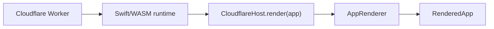

# Cloudflare deployment

This directory is generated from the selected Cloudflare Deployment component.
Swift defines the app. `CloudflareHost` renders it through SwiftWeb's common
`AppRenderer`, and the generated Worker owns request translation and the WASM
lifecycle.



## Local development

Run from the application package root:

```bash
sweb prepare
sweb build
sweb dev
```

The selected Host component determines whether the generated launcher uses
regular actor-enabled WASM or page-only Embedded WASM.

`npm run typecheck` regenerates `worker-configuration.d.ts` from
`wrangler.jsonc` before running TypeScript. The generated declaration is not
stored in the scaffold.

Set non-secret local configuration in `wrangler.jsonc` and secrets in
`.dev.vars`; `.dev.vars` is ignored by Git.

## Validation and deployment

```bash
sweb deploy
```

The Deployment component performs a Wrangler dry run as the final `sweb build`
gate. `sweb deploy` reruns that build first, and remote changes occur only in
the explicit deployment operation.
