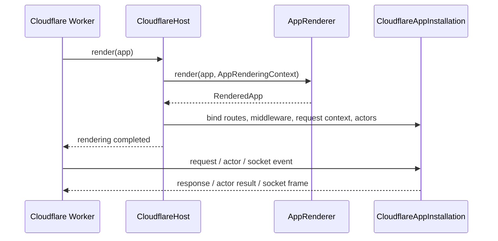

# Cloudflare Host Rendering Contract

The Cloudflare adapter consumes SwiftWeb's `AppRenderer`; it does not reproduce
scene rendering or define a platform-specific application model.

## Ownership

| Layer | Owns |
|---|---|
| App | Scenes, pages, endpoints, security policy, actor system, and client runtime declaration |
| SwiftWeb | Scene rendering, route registration, middleware assembly, and `RequestRuntimeContext` |
| `CloudflareHost` | One render lifecycle and the current `CloudflareAppInstallation` |
| `CloudflareAppInstallation` | `RenderedApp`, page serving, actor dispatch, sessions, and socket transports for one WASM runtime |
| Worker | Bindings, Durable Object storage, WebSocket hibernation, WASI instantiation, and request/response translation |

The host calls `AppRenderer.render` once. `RenderedApp.routes`,
`RenderedApp.middlewares`, and `RenderedApp.requestContext` are passed directly
to the Cloudflare page server. There is no Cloudflare router, storage container,
or application protocol that competes with SwiftWeb's renderer.

## Event boundary

The generated launcher keeps the host alive as an immutable module owner and
forwards six semantic WASM exports:

| Export | Host operation |
|---|---|
| `renderApplication` | `CloudflareHost.render(_:)` |
| `respondToRequest` | `CloudflareHost.respondToRequest()` |
| `invokeActor` | `CloudflareHost.invokeActor()` |
| `openActorSocket` | `CloudflareHost.openActorSocket()` |
| `receiveActorSocketMessage` | `CloudflareHost.receiveActorSocketMessage()` |
| `closeActorSocket` | `CloudflareHost.closeActorSocket()` |

Each WASM instance receives a runtime identifier. Rendering, page responses,
actor results, and socket frames return that identifier across the bridge, so
callbacks from multiple WASM instances cannot resolve another instance's
pending operation.

## Failure and lifecycle

- Rendering failure resets the host to `idle` and reports failure to the Worker;
  no request is served from a partial render.
- A host accepts one successful app render. A second render is a lifecycle
  error rather than a compatibility fallback.
- A failed page-runtime cold start is discarded so the next request can retry.
- Durable Object actor runtime failure is scoped to that object and returns an
  explicit HTTP error.
- Cloudflare configuration and bindings remain in `wrangler.jsonc`; they are not
  exposed through SwiftWeb's `App`.

The host library has two verified target capabilities: regular WASM with the
`Actors` trait, and Embedded WASM without it. The generated Durable Object
application selects regular WASM because `swift-actor-runtime` currently needs
Foundation. Platform selection never changes a declared actor application into
a page-only application.

This is also a production size boundary, not only a compiler distinction. The
minimal actor-enabled fixture measured 48,714 KiB upload / 19,134 KiB gzip with
Wrangler 4.119.0 on 2026-08-05, so it does not satisfy a 3 MiB deployment
budget. The actor-enabled Embedded graph remains a dependency requirement; no
page-only fallback is treated as actor support.

## Removed architecture

The following concepts are intentionally absent:

- `CloudflareApplication: ApplicationProtocol`
- Cloudflare-owned scene lowering and service registration
- `CloudflareActorHost.start(App.Type)`
- the `swiftwebStart` ABI export
- separate `new` and `chat` deployment implementations

Generated applications migrate directly to `CloudflareHost.render(app)` and the
single `application` scaffold.
