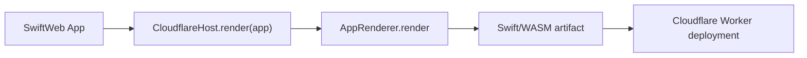
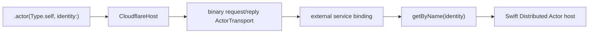

# swift-web-cloudflare

The Cloudflare Host and Deployment adapter for
[SwiftWeb](https://github.com/1amageek/swift-web). SwiftWeb owns application
rendering; this package owns the Cloudflare Worker, Durable Object, WebSocket,
binding, and Swift/WASM boundaries.



## Add the adapter

Add the released package to the application's `Package.swift` dependencies:

```swift
.package(
    url: "https://github.com/1amageek/swift-web-cloudflare.git",
    from: "0.5.0"
)
```

The application target does not need a dependency on
`SwiftWebCloudflareHost`. The generated Host launcher imports that product.
Declaring the package is enough for `sweb` to discover
`Adapter/sweb.json` through the SwiftPM dependency graph.

Select the adapter in the application's source-controlled `sweb.json`:

```json
{
  "schemaVersion": 3,
  "application": {
    "product": "MyApp",
    "module": "MyApp",
    "type": "MyApp"
  },
  "services": {},
  "environments": {
    "production": {
      "host": "swift-web-cloudflare/worker",
      "deployment": "swift-web-cloudflare/workers"
    }
  },
  "defaults": {
    "build": "production",
    "dev": null,
    "deploy": "production"
  }
}
```

## Components

| Component | Responsibility | Swift/WASM profile |
|---|---|---|
| Host `worker` | Pages, endpoints, distributed actors, and actor sockets | Regular WASM with `Actors` |
| Host `page-worker` | Pages and endpoints with generated remote Actor references | Embedded WASM with `Actors` |
| Deployment `workers` | Worker plus SQLite Durable Object actor routing | Accepts `worker` artifact |
| Deployment `page-worker` | Page-serving Worker with external Durable Object actor-service bindings | Accepts `page-worker` artifact |

Both deployments accept the `cloudflare.external-durable-object` service
artifact. An application may therefore declare a separately built and deployed
Durable Object service. Only its Actor contract product is linked for generated
type metadata; the service implementation remains outside the page WASM. The
deployment adapter owns binding names, class names, `script_name`, and route
templates.



The generated bridge forwards the same logical identity to `getByName` and to
the hosted Swift invocation context. A missing, duplicate, or ambiguous binding
fails explicitly. The adapter does not accept identity or arbitrary Swift
expressions from its manifest.

Cancelling the calling Swift task aborts its bridge wait even when the
underlying Durable Object RPC has not settled. Cloudflare does not expose that
RPC as a cancellable operation, so the remote invocation may continue; the
bridge still observes its eventual fulfillment or rejection to avoid an
unhandled Promise while reporting cancellation to Swift immediately.

The artifact contract prevents pairing a page-only Host with an actor
Deployment or vice versa.

## Commands

All lifecycle commands are provided by `sweb`; this package has no competing
CLI:

```bash
sweb prepare --environment production
sweb build --environment production
sweb dev --environment production
sweb deploy --environment production
```

`sweb build` materializes the selected Host and Deployment under:

```text
.swiftweb/generated/environments/production/workspace/
├── services/     independently materialized service workspaces, when selected
├── wasm/         generated Swift package and launcher
└── cloudflare/   Worker source, Wrangler configuration, and Node dependencies
```

`sweb dev` builds the selected Host artifact first, then supervises the
Cloudflare development Worker together with every selected persistent service.
Wrangler generates binding declarations inside this materialized workspace
before TypeScript checking; application overlays do not own a checked-in copy
of environment-specific binding types.

The generated launcher owns one `CloudflareHost` and forwards semantic event
functions:

```swift
private enum WorkerRuntime {
    static let host = CloudflareHost()
}

@_expose(wasm, "renderApplication")
@_cdecl("renderApplication")
func renderApplication() {
    WorkerRuntime.host.render(MyApp())
}
```

Request, actor, and socket exports forward to the same host instance. Generated
external Actor service bindings are passed to `CloudflareHost` at construction.
Adapter templates are generated state; application-specific Wrangler configuration and
verification belong in application overlays and lifecycle tasks.

The Host build sets `SWIFTWEB_HOSTED_APPLICATION=1` while SwiftPM resolves and
compiles the application package. Applications may use this host-neutral build
context to exclude development-only products; they do not read a
Cloudflare-specific composition flag.

## Rendering and routing

- Ordinary requests render through `RenderedApp.routes` and
  `RenderedApp.middlewares`.
- `POST /_swiftweb/actors/invoke` routes by `recipientID` to one Durable Object
  identity in the actor-enabled component.
- `GET /_swiftweb/actors/ws?actor=…` upgrades a hibernatable WebSocket on that
  Durable Object.
- Durable Object SQLite backs `@ActorStorage` state.
- Firebase ID token verification is optional and occurs at the Worker boundary.

`CloudflareHost` does not define another application protocol or container. The
same `App`, `Scene`, middleware, actions, routes, and security policy used by
other Hosts are rendered through SwiftWeb's host-neutral `AppRenderer`.

## Toolchain and size boundary

Both components use the matching Swift 6.4 development snapshot dated
2026-08-14. `page-worker` uses the matching Embedded WASM SDK. `worker` remains
on regular WASM while `swift-actor-runtime` requires Foundation.

The deployment template vendors the JavaScriptKit runtime used to instantiate
the generated WASM. `Package.swift` therefore pins the matching JavaScriptKit
release exactly; update the package version and `runtime.mjs` together so the
Swift imports and JavaScript functions retain one ABI.

The actor-enabled graph is not currently suitable for a 3 MiB upload budget.
On 2026-08-05, Wrangler 4.119.0 measured the optimized fixture at 48,714 KiB
upload / 19,134 KiB gzip. `sweb build` runs Wrangler's dry-run bundler and
checks the compressed size of the complete upload, not the WASM module alone.
`sweb deploy` reruns that build before the real deployment. Actor behavior is
not silently removed to meet a size limit. The Host build also pins Binaryen so
the optimized artifact is reproducible.

See [CloudflareHostRendering.md](Documentation/CloudflareHostRendering.md) for
the ownership and lifecycle contract and
[CloudflareHostConcurrency.md](Documentation/CloudflareHostConcurrency.md) for
the shared-state contract.
