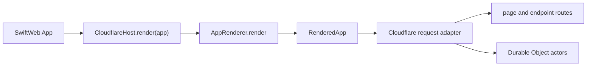

# swift-web-cloudflare

The Cloudflare host adapter for [SwiftWeb](https://github.com/1amageek/swift-web).
SwiftWeb owns declarative app rendering; this package owns the Cloudflare
Worker, Durable Object, WebSocket, binding, and Swift/WASM boundaries.



`CloudflareHost` does not define another application protocol or application
container. The same `App`, `Scene`, middleware, actions, routes, security
configuration, and request runtime used by the native host are rendered once
through SwiftWeb's host-neutral renderer.

## Add the package

During cross-package development, keep SwiftWeb and this adapter as sibling
checkouts and use path dependencies:

```swift
.package(path: "../swift-web-cloudflare")
```

Applications import the library product:

```swift
.product(
    name: "SwiftWebCloudflareHost",
    package: "swift-web-cloudflare"
)
```

## Create a deployment scaffold

```sh
swift run swiftweb-cloudflare install --app MyApp --path /path/to/MyApp
```

The command writes one deployment layout:

```text
deploy/
├── cloudflare/   Worker, generated binding types, Durable Object, Wrangler config
└── wasm/         Swift/WASM launcher and build script
```

The launcher owns one `CloudflareHost` and exposes semantic event functions:

```swift
private let cloudflareHost = CloudflareHost()

@_expose(wasm, "renderApplication")
@_cdecl("renderApplication")
func renderApplication() {
    cloudflareHost.render(MyApp())
}
```

Request, actor, and socket exports forward to the same host instance. The old
`swiftwebStart` entry point and `CloudflareActorHost` application-lowering path
do not exist.

## Build and run locally

Use the pinned Swift 6.4 snapshot and matching WASM SDK:

```sh
cd deploy/wasm
./build.sh

cd ../cloudflare
npm install
npm run typecheck
npm test
npm run dev
```

The current actor-enabled deployment baseline is:

- Toolchain: `swift-6.4.x-DEVELOPMENT-SNAPSHOT-2026-07-23-a`
- SDK: `swift-6.4.x-DEVELOPMENT-SNAPSHOT-2026-07-23-a_wasm`

`SwiftWebCloudflareHost` also compiles with the matching Embedded WASM SDK
when the `Actors` trait is disabled. Actor-enabled applications use the regular
WASM profile because `swift-actor-runtime` currently depends on Foundation;
the adapter does not silently remove actor behavior to force an Embedded build.

### Current actor size boundary

The actor-enabled fixture is not release-ready for a 3 MiB Cloudflare upload
budget. On 2026-08-05, Wrangler 4.119.0 measured the optimized fixture at
48,714 KiB upload / 19,134 KiB gzip. Reaching the deployment budget requires
Embedded-compatible actor serialization in `swift-actor-runtime` and SwiftWeb;
this adapter does not claim that a regular-WASM build satisfies the limit.

Wrangler configuration is stored in `wrangler.jsonc`. `npm run typecheck`
regenerates binding types with `wrangler types`; the Worker source does not
hand-write `Env` or ship a stale generated declaration.

## Request and actor routing

- Ordinary requests render through `RenderedApp.routes` and
  `RenderedApp.middlewares`.
- `POST /_swiftweb/actors/invoke` routes by `recipientID` to one Durable Object
  identity.
- `GET /_swiftweb/actors/ws?actor=…` upgrades a hibernatable WebSocket on the
  same Durable Object.
- Durable Object SQLite backs `@ActorStorage` state.
- Firebase ID token verification is optional and happens at the Worker boundary
  before actor traffic reaches Swift/WASM.

See [CloudflareHostRendering.md](Documentation/CloudflareHostRendering.md) for
the ownership and lifecycle contract and
[CloudflareHostConcurrency.md](Documentation/CloudflareHostConcurrency.md) for
the shared-state contract.
