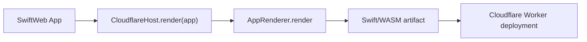

# swift-web-cloudflare

The Cloudflare Host and Deployment adapter for
[SwiftWeb](https://github.com/1amageek/swift-web). SwiftWeb owns application
rendering; this package owns the Cloudflare Worker, Durable Object, WebSocket,
binding, and Swift/WASM boundaries.



## Add the adapter

Add the released package to the application's `Package.swift` dependencies:

```swift
.package(
    url: "https://github.com/1amageek/swift-web-cloudflare.git",
    from: "0.5.0"
)
```

The application target does not need a dependency on
`SwiftWebCloudflareHost`. The generated Host launcher imports that product.
Declaring the package is enough for `sweb` to discover
`Adapter/sweb.json` through the SwiftPM dependency graph.

Select the adapter in the application's source-controlled `sweb.json`:

```json
{
  "schemaVersion": 2,
  "application": {
    "product": "MyApp",
    "module": "MyApp",
    "type": "MyApp"
  },
  "environments": {
    "production": {
      "host": "swift-web-cloudflare/worker",
      "deployment": "swift-web-cloudflare/workers"
    }
  },
  "defaults": {
    "build": "production",
    "dev": null,
    "deploy": "production"
  }
}
```

## Components

| Component | Responsibility | Swift/WASM profile |
|---|---|---|
| Host `worker` | Pages, endpoints, distributed actors, and actor sockets | Regular WASM with `Actors` |
| Host `page-worker` | Pages and endpoints without distributed actors | Embedded WASM with `Actors` disabled |
| Deployment `workers` | Worker plus SQLite Durable Object actor routing | Accepts `worker` artifact |
| Deployment `page-worker` | Page-serving Worker without actor bindings | Accepts `page-worker` artifact |

The artifact contract prevents pairing a page-only Host with an actor
Deployment or vice versa.

## Commands

All lifecycle commands are provided by `sweb`; this package has no competing
CLI:

```bash
sweb prepare --environment production
sweb build --environment production
sweb dev --environment production
sweb deploy --environment production
```

`sweb build` materializes the selected Host and Deployment under:

```text
.swiftweb/generated/environments/production/workspace/
├── wasm/         generated Swift package and launcher
└── cloudflare/   Worker source, Wrangler configuration, and Node dependencies
```

The generated launcher owns one `CloudflareHost` and forwards semantic event
functions:

```swift
private enum WorkerRuntime {
    static let host = CloudflareHost()
}

@_expose(wasm, "renderApplication")
@_cdecl("renderApplication")
func renderApplication() {
    WorkerRuntime.host.render(MyApp())
}
```

Request, actor, and socket exports forward to the same host instance. Adapter
templates are generated state; application-specific Wrangler configuration and
verification belong in application overlays and lifecycle tasks.

The Host build sets `SWIFTWEB_HOSTED_APPLICATION=1` while SwiftPM resolves and
compiles the application package. Applications may use this host-neutral build
context to exclude development-only products; they do not read a
Cloudflare-specific composition flag.

## Rendering and routing

- Ordinary requests render through `RenderedApp.routes` and
  `RenderedApp.middlewares`.
- `POST /_swiftweb/actors/invoke` routes by `recipientID` to one Durable Object
  identity in the actor-enabled component.
- `GET /_swiftweb/actors/ws?actor=…` upgrades a hibernatable WebSocket on that
  Durable Object.
- Durable Object SQLite backs `@ActorStorage` state.
- Firebase ID token verification is optional and occurs at the Worker boundary.

`CloudflareHost` does not define another application protocol or container. The
same `App`, `Scene`, middleware, actions, routes, and security policy used by
other Hosts are rendered through SwiftWeb's host-neutral `AppRenderer`.

## Toolchain and size boundary

Both components use the matching Swift 6.4 development snapshot dated
2026-07-23. `page-worker` uses the matching Embedded WASM SDK. `worker` remains
on regular WASM while `swift-actor-runtime` requires Foundation.

The deployment template vendors the JavaScriptKit runtime used to instantiate
the generated WASM. `Package.swift` therefore pins the matching JavaScriptKit
release exactly; update the package version and `runtime.mjs` together so the
Swift imports and JavaScript functions retain one ABI.

The actor-enabled graph is not currently suitable for a 3 MiB upload budget.
On 2026-08-05, Wrangler 4.119.0 measured the optimized fixture at 48,714 KiB
upload / 19,134 KiB gzip. `sweb build` runs the Wrangler dry-run gate, and
`sweb deploy` reruns that build before the real deployment. Actor behavior is
not silently removed to meet a size limit.

See [CloudflareHostRendering.md](Documentation/CloudflareHostRendering.md) for
the ownership and lifecycle contract and
[CloudflareHostConcurrency.md](Documentation/CloudflareHostConcurrency.md) for
the shared-state contract.
