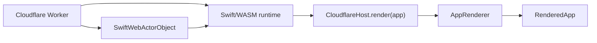

# Cloudflare deployment

This directory is the Cloudflare adapter for the SwiftWeb application. Swift
defines the app. `CloudflareHost` renders it through SwiftWeb's common
`AppRenderer`, and this Worker owns Cloudflare bindings, Durable Objects,
request translation, WebSocket hibernation, and the WASM lifecycle.



## Local development

```sh
../wasm/build.sh
npm install
npm run typecheck
npm test
npm run dev
```

The generated Durable Object launcher uses the matching Swift 6.4 regular
WASM SDK. Its actor runtime depends on Foundation, so the build does not remove
actor behavior in order to claim Embedded compatibility.

`npm run typecheck` regenerates `worker-configuration.d.ts` from
`wrangler.jsonc` before running TypeScript. The generated declaration is not
stored in the scaffold.

The current actor-enabled graph does not satisfy a 3 MiB compressed deployment
budget. Treat `npm run deploy:check` and the reported upload size as a required
release gate until the actor runtime supports Embedded WASM.

Wrangler uses local Durable Object storage by default. Set non-secret local
configuration in `wrangler.jsonc` and secrets in `.dev.vars`; `.dev.vars` is
ignored by Git.

## Authentication

Set `SWIFTWEB_AUTH_PROJECT_ID` to a Firebase project identifier to require ID
token verification before actor traffic reaches a Durable Object. For local
Firebase Auth emulator use, set `SWIFTWEB_AUTH_EMULATOR_HOST`. Leave the project
identifier empty to rely on the app's actor authorization policy alone.

The browser sends `Authorization: Bearer <token>` for HTTP actor invocations.
WebSocket clients use `?access_token=<token>` because browser WebSocket APIs
cannot set handshake headers.

## Validation and deployment

```sh
npm run deploy:check
npm run deploy
```

`npm run deploy:check` performs a Wrangler dry run. Deployment remains an
explicit operation and is not performed by the Swift build.
